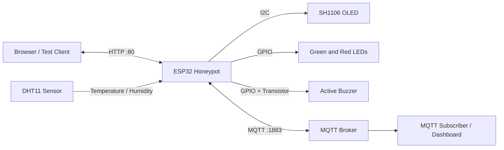

# ESP32 IoT Honeypot

### Smart Home Gateway Security Monitoring System

An educational, low-cost **Internet of Things (IoT) honeypot** built with an **ESP32**. The device imitates a smart-home gateway and monitors suspicious interactions with its local HTTP interface. It also reads temperature and humidity, displays live information on an OLED, triggers visual and audible alerts, and publishes telemetry over MQTT.

> [!IMPORTANT]
> This is a **teaching and demonstration prototype**, not a production intrusion detection system. Deploy it only on networks you own or have permission to test. Its web interface is a decoy, and the implementation does **not** include HTTPS/TLS or authenticated administration.

## Table of Contents

- [Features](#features)
- [How It Works](#how-it-works)
- [Detection Rules](#detection-rules)
- [Hardware Requirements](#hardware-requirements)
- [Wiring and Connections](#wiring-and-connections)
- [Software Requirements](#software-requirements)
- [Project Structure](#project-structure)
- [Getting Started](#getting-started)
- [Web Interface](#web-interface)
- [MQTT Integration](#mqtt-integration)
- [Security States and Alerts](#security-states-and-alerts)
- [Testing](#testing)
- [Limitations](#limitations)
- [Future Improvements](#future-improvements)
- [References](#references)

## Features

- **Smart-home gateway decoy:** HTTP interface with a simulated administrator login.
- **Brute-force monitoring:** Detects repeated failed login submissions.
- **Reconnaissance monitoring:** Detects repeated requests to suspicious or nonexistent paths.
- **Request-flood monitoring:** Counts high-frequency HTTP requests from a source IP.
- **Three security states:** `NORMAL`, `WARNING`, and `ATTACK`.
- **Environmental sensing:** DHT11 temperature and humidity readings every 2 seconds.
- **Local feedback:** SH1106 OLED, green/red LEDs, and non-blocking active-buzzer patterns.
- **Security event history:** Circular in-memory log of the **20 most recent events**.
- **Web-based logs:** Dedicated `/security-logs` page.
- **MQTT telemetry:** Security events, device status, and sensor measurements on separate topics.
- **Modular Arduino code:** Separate files for configuration, web handling, security rules, MQTT, display, and alerts.

## How It Works



The ESP32 hosts a web interface that looks like a small smart-home gateway. Incoming requests are inspected by lightweight counters. If an activity threshold is reached, the system logs a security event, updates its current state, and activates the corresponding indicators. When connected to the MQTT broker, the device also publishes security and operating information for remote observation.

The main Arduino loop coordinates HTTP handling, MQTT maintenance, sensor readings, security-window resets, and buzzer timing without long blocking delays during normal operation.

## Detection Rules

The project uses fixed counting windows rather than deep packet inspection or machine learning.

| Detection type | Measurement window | WARNING threshold | ATTACK threshold |
| --- | --- | --- | --- |
| Brute-force login | 30 seconds | 3 failed attempts | 5 failed attempts |
| Reconnaissance | 20 seconds | 2 suspicious paths | 4 suspicious paths |
| HTTP request flood | 5 seconds | 10 requests from a source IP | 20 requests from a source IP |

- `ATTACK` has priority over `WARNING`, and `WARNING` has priority over `NORMAL`.
- Events are recorded when defined thresholds are reached.
- After a counting window expires, its counter is reset and the security state is evaluated again.
- The `/security-logs` route and `/favicon.ico` are excluded from attack counting in the documented implementation.

### Configuration excerpt

The documented thresholds are:

```cpp
// Security thresholds
const unsigned long LOGIN_WINDOW = 30000;
const int LOGIN_WARNING_THRESHOLD = 3;
const int LOGIN_ATTACK_THRESHOLD = 5;

const unsigned long RECON_WINDOW = 20000;
const int RECON_WARNING_THRESHOLD = 2;
const int RECON_ATTACK_THRESHOLD = 4;

const unsigned long FLOOD_WINDOW = 5000;
const int FLOOD_WARNING_THRESHOLD = 10;
const int FLOOD_ATTACK_THRESHOLD = 20;

const int MAX_EVENTS = 20;
```

## Hardware Requirements

| Component | Specification / role | Quantity |
| --- | --- | ---: |
| ESP32 development board | Wi-Fi-enabled main controller | 1 |
| DHT11 | Temperature and humidity sensor | 1 |
| SH1106 OLED | 128 × 64 monochrome, I2C address `0x3C` | 1 |
| Green LED | Normal-state indicator | 1 |
| Red LED | Warning/attack indicator | 1 |
| Active buzzer | TMB12A05 or the specified prototype buzzer | 1 |
| NPN transistor | 2N2222A buzzer switching stage | 1 |
| Resistor | 220 Ω for transistor base drive | 1 |
| Breadboard and jumper wires | Prototype connections | 1 set |
| USB cable / regulated supply | Programming and power | 1 |

## Wiring and Connections

These are the **GPIO assignments from the documented sketch**. In particular, the OLED uses non-default I2C pins.

| Device / signal | ESP32 connection | Notes |
| --- | --- | --- |
| DHT11 DATA | `GPIO22` | Digital sensor input |
| OLED SDA | `GPIO5` | I2C data |
| OLED SCL | `GPIO21` | I2C clock |
| OLED address | `0x3C` | SH1106, 128 × 64 |
| Green LED | `GPIO23` | `NORMAL` indicator |
| Red LED | `GPIO4` | `WARNING` / `ATTACK` indicator |
| Buzzer driver | `GPIO18` | Through 220 Ω resistor and 2N2222A transistor |
| HTTP server | TCP port `80` | Local Wi-Fi network |
| MQTT broker | TCP port `1883` | Configurable broker connection |

**Electrical note:** ESP32 GPIO uses **3.3 V logic**. Verify the power requirements of your particular DHT11, OLED, LED, and buzzer modules; use a shared ground and do not drive the buzzer directly from the ESP32 GPIO in place of the documented transistor stage.

## Software Requirements

- [Arduino IDE](https://www.arduino.cc/en/software)
- [Arduino ESP32 board support](https://docs.espressif.com/projects/arduino-esp32/en/latest/)
- A Wi-Fi network that the ESP32 can join
- An accessible MQTT broker (for remote telemetry)

### Arduino libraries

| Library | Purpose |
| --- | --- |
| `WiFi.h` | Wi-Fi connectivity |
| `WebServer.h` | Embedded HTTP server |
| [`PubSubClient`](https://github.com/knolleary/pubsubclient) | MQTT client |
| `Wire.h` | I2C interface |
| `Adafruit_GFX` | OLED graphics primitives |
| [`Adafruit_SH110X`](https://github.com/adafruit/Adafruit_SH110x) | SH1106 display support |
| [`DHT`](https://github.com/adafruit/DHT-sensor-library) | DHT11 readings |

`WiFi.h`, `WebServer.h`, and `Wire.h` are provided through the installed board/framework packages; the other libraries can be installed with Arduino IDE's Library Manager.

## Project Structure

The documentation describes the following modular Arduino IDE layout:

```text
IoT_Honeypot_Modular/
├── IoT_Honeypot_Modular.ino   # setup(), loop(), shared objects, route setup
├── Config.h                  # Wi-Fi/MQTT, GPIOs, timings, thresholds
├── Types.h                   # SecurityState and SecurityEvent types
├── 01_Utilities.ino          # Timestamps and HTML/JSON escaping
├── 02_MQTT.ino               # Broker connection and publication
├── 03_Sensors_OLED.ino       # Sensor / OLED display functions
├── 04_Buzzer.ino             # Non-blocking audible alerts
├── 05_Security.ino           # Detection, logging, state logic
├── 06_WebPages.ino           # Decoy interface and log page markup
└── 07_WebHandlers.ino        # HTTP route handlers
```

## Getting Started

1. **Assemble the circuit.** Wire the DHT11, SH1106 OLED, LEDs, and transistor-driven active buzzer according to the pin table above.
2. **Install the toolchain.** Install Arduino IDE, add the ESP32 board package, and install the required libraries.
3. **Open the sketch.** Place all source files in a directory named `IoT_Honeypot_Modular` and open `IoT_Honeypot_Modular.ino` in Arduino IDE.
4. **Configure networking.** Update the Wi-Fi and MQTT broker settings in `Config.h` according to the source code. Keep real SSIDs, passwords, and private service credentials out of public commits.
5. **Select your ESP32 board and port.** Compile and upload the sketch from Arduino IDE.
6. **Open Serial Monitor at `115200` baud.** Use it to inspect startup messages and MQTT/security diagnostics.
7. **Open the gateway.** Find the ESP32's local IP address and visit `http://<ESP32_IP>/` from a browser connected to the same test network.
8. **Inspect events.** Open `http://<ESP32_IP>/security-logs` and, if configured, subscribe to the MQTT topics listed below.

**Startup behavior:** The documented sketch waits for Wi-Fi in `setup()` and stops startup if OLED initialization fails. Confirm the wiring and network configuration first if it does not proceed.

## Web Interface

| Interface | Description |
| --- | --- |
| `/` | Decoy Smart Home Gateway homepage displaying sensor information and a login link |
| Administrator login | Simulated login form used to observe repeated failed authentication attempts |
| `/security-logs` | Web table displaying recent recorded security events |
| Unrecognized/restricted paths | Can contribute to reconnaissance detection |

The administrator interface is a **decoy**, not an authenticated control panel. The HTTP server listens on port **80** and should be used in an isolated, authorized test environment.

## MQTT Integration

The ESP32 publishes JSON payloads through an MQTT broker on port **1883** when the broker is reachable.

| Topic | Purpose |
| --- | --- |
| `iot/honeypot/events` | Security-event messages |
| `iot/honeypot/status` | Retained online/security-state/IP status |
| `iot/honeypot/sensors` | Temperature and humidity values |

The sketch includes MQTT reconnection attempts at approximately **5-second intervals** and a retained **Last Will** message for unexpected disconnects.

The DHT11 is read every **2 seconds**, and sensor data is published every **10 seconds** during normal operation. Security events are published while a broker connection is active; there is no offline delivery queue.

You can monitor the topics with a suitable MQTT client, for example:

```bash
mosquitto_sub -h <BROKER_HOST> -p 1883 -t 'iot/honeypot/#' -v
```

Replace `<BROKER_HOST>` with your configured broker hostname or IP. The command is an example for systems with the Mosquitto client utilities installed; MQTT message payload fields depend on the provided Arduino source.

## Security States and Alerts

| State | Indicators | Meaning |
| --- | --- | --- |
| `NORMAL` | Green LED on; buzzer off | No active detection threshold reached |
| `WARNING` | Red LED on; short beep followed by a longer pause | At least one warning threshold reached |
| `ATTACK` | Red LED on; faster repeating buzzer pattern | At least one attack threshold reached |

The OLED shows the security state, sensor readings, stored event count, and MQTT connection status.

Security event timestamps use **uptime** (`T+HH:MM:SS`) rather than actual calendar date/time. The circular buffer stores **up to 20 events** in RAM and overwrites the oldest entry when full.

## Testing

The project documentation provides the following functional test cases. Their **Pass** labels are reported in that document; they are not an independent hardware verification performed for this README.

| ID | Test scenario | Documented status |
| --- | --- | --- |
| TC-01 | Startup with valid Wi-Fi configuration | Pass |
| TC-02 | DHT11 readings refresh and invalid values are ignored | Pass |
| TC-03 | Gateway homepage is available | Pass |
| TC-04 | 3 failed logins in 30 s trigger `WARNING` | Pass |
| TC-05 | 5 failed logins in 30 s trigger `ATTACK` | Pass |
| TC-06 | 2 suspicious paths in 20 s trigger `WARNING` | Pass |
| TC-07 | 4 suspicious paths in 20 s trigger `ATTACK` | Pass |
| TC-08 | 10 HTTP requests in 5 s trigger `WARNING` | Pass |
| TC-09 | 20 HTTP requests in 5 s trigger `ATTACK` | Pass |
| TC-10 | `/security-logs` shows recent event records | Pass |
| TC-11 | MQTT publishes events, status, and sensor readings | Pass |
| TC-12 | Expired detection windows reset their counters | Pass |

For an end-to-end demonstration, capture the OLED display, the web pages, Serial Monitor output, and MQTT subscriber messages while testing on a network you control.

## Limitations

- Simple fixed thresholds can produce false positives and are not equivalent to a full intrusion detection system.
- The web interface does **not** implement HTTPS/TLS or authenticated administration.
- Security history is **RAM-only** and is lost when the device restarts.
- Only the **20 most recent events** are retained locally.
- MQTT events are **not queued** while the broker is offline.
- Event timestamps show device uptime, not wall-clock time.
- The DHT11 has limited measurement precision; ESP32 memory and processing resources also constrain scalability.
- Wi-Fi setup blocks until the connection succeeds, and OLED initialization is required by the documented startup sequence.

## Future Improvements

- Add persistent event storage (flash, SD card, or an external database).
- Add accurate timestamps using NTP or an RTC.
- Add independent per-source counters across detector types and secure threshold configuration.
- Introduce TLS for management/telemetry where appropriate while isolating the honeypot from real services.
- Connect MQTT feeds to a monitoring dashboard or alert-correlation platform.
- Add automated regression testing, controlled load tests, and resource-usage measurements.

## References

1. [Arduino ESP32 Wi-Fi API — Espressif](https://docs.espressif.com/projects/arduino-esp32/en/latest/api/wifi.html)
2. [PubSubClient — MQTT Arduino library](https://github.com/knolleary/pubsubclient)
3. [Adafruit SH110X Arduino library](https://github.com/adafruit/Adafruit_SH110x)
4. [Adafruit DHT Sensor Library](https://github.com/adafruit/DHT-sensor-library)
5. [Arduino `millis()` reference](https://docs.arduino.cc/language-reference/en/functions/time/millis/)

---

**Project context:** Internet of Things (IoT) course project. This README was adapted from the supplied *ESP32 IoT Honeypot: Smart Home Gateway Security Monitoring System* documentation.
